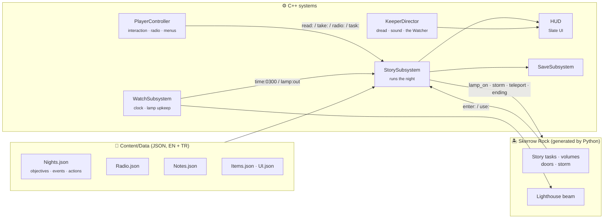

<div align="center">


# THE LAST WATCH

**Skerrow Rock · October 1974**

*A first-person, story-driven mystery about a lighthouse that was never built for ships.*

<br>


[About](#-about) · [Screenshots](#-screenshots) · [Features](#-features) · [Controls](#-controls) · [Building](#-building-from-source) · [Under the hood](#-under-the-hood) · [Credits](#-credits) · [Türkçe](#-türkçe)

</div>

---

## 🌊 About

> *"Never miss the 3 AM check."*
> — the first page of Elias Marr's journal

You are the new keeper of **Skerrow Rock**, a nameless scrap of granite in the North Atlantic that barely makes it onto the charts. The supply boat leaves you on the pier and won't be back for a month. Your predecessor, **Elias Marr**, is listed as *missing*.

Every night you wind the clockwork, fill the reservoir, keep the beam turning and report in to **Margaret** on the mainland. And every night the island gives up a little more: journal pages in Elias's hand, a voice reading numbers on a frequency that shouldn't exist, lights in the fog where no ship should be.

Somewhere between a Cold War secret and something much older, you'll have to decide what the light is really for, and whether to keep it burning.

<table>
<tr>
<td width="33%" valign="top">

### 🕯️ Atmosphere over action
No combat, no health bar. The tension comes from light, sound, fog and silence.

</td>
<td width="33%" valign="top">

### 📻 Told through voices
No one on screen. Every character reaches you through the radio, a tape or a page.

</td>
<td width="33%" valign="top">

### 🌫️ An island that changes
Each night the rock is a little different. The story is written into the place itself.

</td>
</tr>
</table>

---

## 📸 Screenshots

<table>
<tr>
<td width="50%"></td>
<td width="50%"></td>
</tr>
<tr>
<td align="center"><sub><b>1975 kHz.</b> Someone is still on the line.</sub></td>
<td align="center"><sub><b>Elias's journal.</b> Every page is collected and re-readable.</sub></td>
</tr>
<tr>
<td width="50%"></td>
<td width="50%"></td>
</tr>
<tr>
<td align="center"><sub><b>The North Atlantic.</b> Nothing out there. Probably.</sub></td>
<td align="center"><sub><b>Storm nights.</b> Rain, wind, and the beam above you.</sub></td>
</tr>
<tr>
<td width="50%"></td>
<td width="50%"></td>
</tr>
<tr>
<td align="center"><sub><b>The keeper's cottage.</b> Elias left in a hurry.</sub></td>
<td align="center"><sub><b>Look again.</b> Was that there before?</sub></td>
</tr>
</table>

---

## ✨ Features

|   | Feature | What it means in play |
|:-:|---|---|
| 🌙 | **Five nights, two endings** | A full story arc from your arrival to a final choice at the lamp. Each night opens new places and new questions. |
| 🗼 | **A lighthouse you can climb** | 94 spiral steps up the tower to a working lantern room, with a rotating beam that lights the fog. |
| ⏱️ | **The keeper's watch** | A pocket watch runs from 21:30 to dawn and chimes on the hour. Something answers at 3 AM. Press <kbd>T</kbd> to check it. |
| 🔧 | **Lamp upkeep** | The clockwork runs down and the paraffin burns low. Neglect them and the beam slows, stops, and goes out, and the dark notices. |
| 📻 | **A tunable radio** | Turn the dial yourself. Find Margaret, find the numbers station, find voices that shouldn't be there, and answer some of them. |
| 📜 | **Documents & inventory** | Journals, letters and files you can read page by page and revisit at any time. |
| 🎚️ | **A director that watches you** | Fear builds with time, darkness and the state of the lamp. It shapes the colour grade, the procedural soundscape and what appears in the fog. |
| ⛈️ | **Weather** | Wind, fog, rain and full storms with thunder on the later nights. |
| 💾 | **Autosave & chapters** | Progress is saved at the start of every night; replay any night you've reached from the title screen. |
| 🌐 | **English & Turkish** | All text, subtitles and menus in both languages, switchable at any time. Adjustable subtitle size. |
| 🎮 | **Keyboard & gamepad** | Full support for both, including the radio and menus. |

---

## 🎮 Controls

<table>
<tr><th>Action</th><th>Keyboard &amp; mouse</th><th>Gamepad</th></tr>
<tr><td>Move / look</td><td><kbd>W</kbd> <kbd>A</kbd> <kbd>S</kbd> <kbd>D</kbd> + mouse</td><td>Left / right stick</td></tr>
<tr><td>Interact · hold to work</td><td><kbd>E</kbd></td><td><kbd>A</kbd></td></tr>
<tr><td>Jump</td><td><kbd>Space</kbd></td><td><kbd>Y</kbd></td></tr>
<tr><td>Crouch (hold · toggle)</td><td><kbd>Ctrl</kbd> · <kbd>C</kbd></td><td><kbd>R3</kbd></td></tr>
<tr><td>Sprint</td><td><kbd>Shift</kbd></td><td>—</td></tr>
<tr><td>Flashlight</td><td><kbd>F</kbd></td><td><kbd>LB</kbd></td></tr>
<tr><td>Check your watch</td><td><kbd>T</kbd></td><td>D-pad ↑</td></tr>
<tr><td>Inventory &amp; documents</td><td><kbd>Tab</kbd> / <kbd>I</kbd></td><td><kbd>Menu</kbd></td></tr>
<tr><td>Tune the radio</td><td><kbd>A</kbd> <kbd>D</kbd> / mouse wheel</td><td>D-pad ← →</td></tr>
<tr><td>Answer on the radio</td><td><kbd>1</kbd> <kbd>2</kbd> <kbd>3</kbd></td><td><kbd>X</kbd> <kbd>Y</kbd> <kbd>B</kbd></td></tr>
<tr><td>Pause</td><td><kbd>Esc</kbd> / <kbd>P</kbd></td><td><kbd>View</kbd></td></tr>
</table>

---

## 🛠️ Building from source

> [!IMPORTANT]
> Several third-party art and sound packs from [Fab](https://www.fab.com) are **not stored in this repository**, because their licences don't allow redistribution. They are all free; [`CREDITS.md`](CREDITS.md) lists every one with its link and target folder. Without them the code compiles, but the island map can't be built.

**Requirements:** Windows 10/11 · Unreal Engine **5.7** · Visual Studio 2022+ with the *Game development with C++* workload · [Git LFS](https://git-lfs.com)

```bash
git lfs install
git clone https://github.com/omotechweb/TheLastWatch.git
```

<details>
<summary><b>1. Add the Fab packs</b></summary>

<br>

For every pack in [`CREDITS.md`](CREDITS.md) marked *(not in git)*:

- **Unreal Engine format:** on Fab press **Add to My Library**, then in the Epic Games Launcher go to **Library → Fab Library → Add to Project → TheLastWatch**.
- **FBX downloads** (the Megascans cliff): download into `Imports/` and run `Scripts/Editor/import_assets.py` (step 3).

</details>

<details>
<summary><b>2. Compile</b> (with the editor closed)</summary>

<br>

```powershell
powershell -File Scripts/build.ps1
```

</details>

<details>
<summary><b>3. Generate the island</b></summary>

<br>

The whole map is produced by Python editor scripts and is never edited by hand. Run them in this order:

```powershell
powershell -File Scripts/run_python.ps1 Scripts/Editor/import_assets.py -Editor
powershell -File Scripts/run_python.ps1 Scripts/Editor/build_island_terrain.py -Editor
powershell -File Scripts/run_python.ps1 Scripts/Editor/build_lighthouse.py
powershell -File Scripts/run_python.ps1 Scripts/Editor/build_bunker.py
powershell -File Scripts/run_python.ps1 Scripts/Editor/build_skerrow_map.py
```

</details>

<details>
<summary><b>4. Play</b></summary>

<br>

```powershell
powershell -File Scripts/play.ps1
```

Developer console commands (<kbd>`</kbd> in game) such as `DebugSetNight 3`, `DebugOpenNote elias_01` and `DebugAutoplay 5` are documented in [`CLAUDE.md`](CLAUDE.md).

</details>

---

## 🔬 Under the hood

All gameplay is **C++** (~8,000 lines) with a **Slate** interface built in code. No Blueprint logic. The story is entirely **data-driven**: every line of dialogue, note, radio broadcast and objective lives in JSON, so writing a night never means touching code.



| Folder | Contents |
|---|---|
| [`Source/TheLastWatch/Game`](Source/TheLastWatch/Game) | Story, clock and lamp, atmosphere director, procedural synth, interactables, HUD, saves |
| [`Content/Data`](Content/Data) | The whole script: nights, radio, documents, items and interface text in English and Turkish |
| [`Scripts/Editor`](Scripts/Editor) | Python that builds the terrain, lighthouse interior, bunker and the full map |
| [`Scripts`](Scripts) | Build, play, screenshot and real-keypress test automation |
| [`GDD.md`](GDD.md) | Game design document (Turkish) |

---

## 🙏 Credits

Lighthouse model by **[DylanHayes](https://www.fab.com/listings/42454f1c-67a2-4460-bd41-741aeb6ecf3f)** (CC-BY). The cabins, furniture, radio, power plant, sea, wind, thunder, footsteps and cliffs come from creators on Fab. The full list with licences is in [**CREDITS.md**](CREDITS.md).

Built on Unreal Engine 5.7. Third-party assets remain the property of their creators.

---

## 🇹🇷 Türkçe

**The Last Watch**, 1974'te Kuzey Atlantik'teki ıssız Skerrow Rock adasında geçen, birinci şahıs, hikâye odaklı bir gerilim/gizem oyunu. Yeni fener bekçisi olarak kaybolan selefin Elias Marr'ın izini sürüyor, her gece lambayı ayakta tutuyor, telsizden anakarayla konuşuyor ve fenerin aslında ne için yanması gerektiğini keşfediyorsun.

- 5 gece, 2 son; dövüş yok, gerilim tamamen ışık, ses ve sisten
- Tırmanılabilen fener kulesi, çalışan lamba ve bakım sistemi (zemberek + gazyağı)
- Elle ayarlanan telsiz, cevap verilebilen çağrılar, sayı istasyonu
- Bütün metinler ve altyazılar **İngilizce ve Türkçe**, oyun içinden değiştirilebilir

Derleme adımları yukarıdaki [Building from source](#-building-from-source) bölümünde.

<div align="center">

<br>

<sub>Keep the light burning.</sub>

</div>
